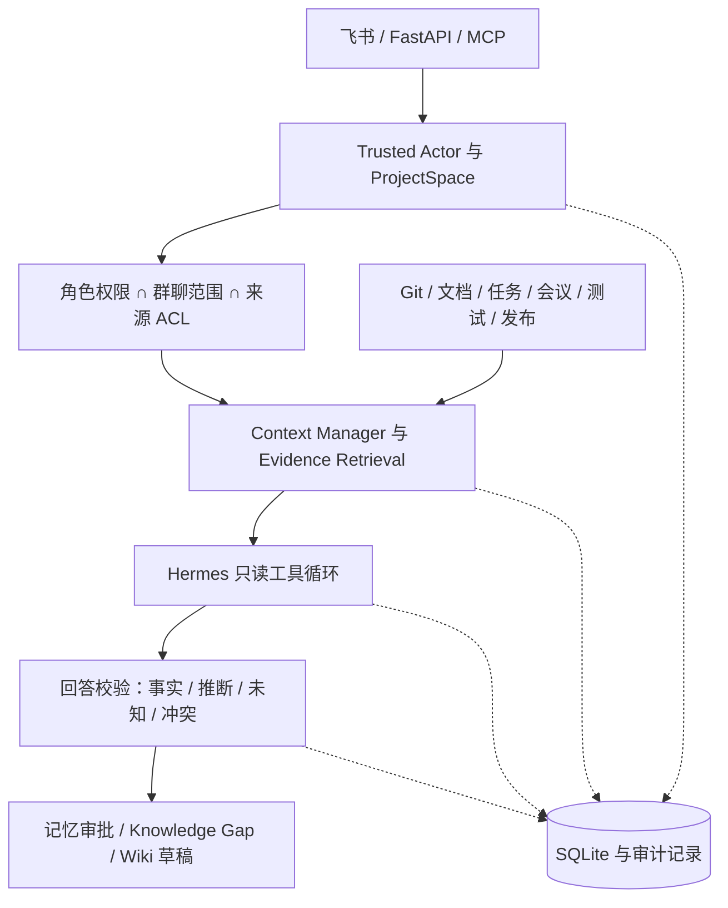

# ProjectLens

ProjectLens 是面向软件研发团队的项目理解与协作 Agent 平台。

它解决的不是“如何把一个大模型接进群聊”，而是如何让产品、研发、测试、项目经理和管理者围绕同一批**授权、可追溯、可验证的项目事实**协作。

ProjectLens 为 Hermes 等 Agent Runtime 提供项目边界、身份校验、权限控制、证据检索、上下文治理、记忆审批和知识缺口闭环，使 AI 能够进入真实研发协作场景，同时保持可解释、可审计和可控。

## 为什么需要 ProjectLens

研发团队使用不同语言关注同一个项目：产品关注目标和需求范围，研发关注代码和架构，测试关注验收和质量，项目经理关注进度和责任人，管理者关注交付和风险。

传统资料分散在代码仓库、文档、任务、会议、测试和发布记录中。更大的问题是不同角色经常基于不同版本、不同权限和不同解释形成结论，导致：

- 需求在业务语言和技术实现之间失真；
- 会议结论留在聊天记录中，无法成为正式依据；
- AI 被长群聊和无关历史干扰；
- 新人 onboarding 依赖少数核心成员；
- 测试发现风险后，项目管理侧难以快速判断影响；
- AI 发现资料不足时只能说“不知道”，没人负责补全。

ProjectLens 把这些问题转化为项目边界、角色视图、Evidence、Context Snapshot、Memory Proposal 和 Knowledge Gap 等可治理对象。

## 一句话定位

> ProjectLens 是企业研发团队的证据驱动项目协作 Agent。它让不同角色在不扩大权限的前提下，基于同一批项目事实理解问题、调查风险、沉淀知识并推动后续行动。

## ProjectLens 与 Hermes 的关系

ProjectLens 不重复实现 Hermes 的模型推理和工具循环，而是为 Hermes 增加企业研发环境所需要的治理层：

```text
Hermes：
理解问题 -> 规划调查 -> 调用工具 -> 组织回答

ProjectLens：
确认项目 -> 验证身份 -> 过滤权限 -> 准备上下文
-> 提供证据 -> 校验回答 -> 审批写入 -> 记录审计 -> 推动闭环
```

直接把 Hermes 接入飞书可以提供自然语言问答，但企业项目还需要知道当前讨论属于哪个项目、用户能访问哪些资料、回答来自哪些来源、哪些内容仍然未知，以及结论能否成为正式团队记忆。ProjectLens 负责这些边界和流程，Hermes 负责在受控范围内理解和调查。

## 核心能力

### ProjectSpace 项目边界

ProjectSpace 将租户、项目、仓库、文档、连接器、飞书群、成员、角色策略和来源白名单绑定为一个运行时边界。

它让 Agent 在调用工具前明确：

- 当前问题属于哪个项目；
- 当前操作者是什么身份和角色；
- 当前群聊能看到哪些内容；
- 哪些来源允许进入调查；
- 回答和写入允许达到什么范围。

### 角色化项目问答

同一条事实可以按不同角色的工作目标组织：

| 角色 | 关注重点 |
| --- | --- |
| 产品经理 | 需求目标、业务规则、验收标准和待确认项 |
| 研发工程师 | 模块关系、代码证据、依赖、变更影响和技术风险 |
| 测试工程师 | 验收依据、回归范围、质量缺口和发布风险 |
| 项目经理 | 进度、阻塞、负责人、缺口和协作状态 |
| 管理者 | 交付、资源、关键风险和决策 |
| 新人/实习生 | 项目目标、模块职责、流程和已确认背景 |

角色视图不是简单改变语气，而是在同一批授权事实基础上调整信息优先级、解释深度和行动建议。

### Evidence 驱动回答

ProjectLens 将 Git、项目文档、任务、会议、测试、发布和运行信号统一为来源记录，再生成可用于回答的 Evidence。

回答尽量区分：

- 已有来源支持的事实；
- 基于证据的推断；
- 尚未确认的未知项；
- 来源之间的冲突；
- 已经过期或需要复查的内容。

系统不会为了让回答看起来完整而编造没有来源支持的数字、状态、准确率、SLA 或风险结论。

### Context Manager 与 Context Snapshot

ProjectLens 根据问题、项目边界、角色、Evidence 相关性、记忆状态和 token 预算准备上下文：

```text
当前问题与用户选择
-> 项目、身份、角色和权限
-> 关键 Evidence 与正式 ProjectMemory
-> 相关历史、工具结果和会议摘要
-> 无关闲聊、重复消息和低优先级历史
```

Context Snapshot 保存一次回答实际使用的历史、证据和记忆引用。来源、权限或记忆状态发生变化时，系统显式报告变化，而不是静默替换上下文。

### 受控记忆

Agent 的运行观察不能直接成为团队正式知识：

```text
运行观察 / Episode
-> MemoryProposal
-> 证据、权限、冲突和有效期校验
-> 人工审批
-> ProjectMemory
-> 复核、替代或撤销
```

正式记忆可以关联来源、Evidence、提议人、审批人、可见范围、有效期和版本关系，避免一次对话中的临时判断污染项目知识。

### Knowledge Gap 知识缺口闭环

当系统发现资料缺失、来源冲突、来源过期、缺少负责人、缺少决策或缺少验收标准时，不只返回“不知道”，而是生成可治理的 Knowledge Gap：

```text
发现缺口 -> 分配负责人 -> 补充资料或确认决策
-> 重新同步与检索 -> 验证 -> 关闭缺口
```

缺口保存影响、建议动作、责任人、状态、复查记录和关闭依据，帮助团队把不确定性转化为可执行的工作。

## 典型场景

- 在飞书项目群中询问项目状态、需求、负责人、发布和风险；
- 对代码变更生成产品、研发、测试和管理者都能理解的影响说明；
- 检查需求、会议、任务、测试和发布记录是否一致；
- 为新人提供受权限控制的项目 onboarding；
- 通过记忆审批保存架构事实、团队约定和正式决策；
- 通过 Knowledge Gap 推动资料补充、责任分配和复查；
- 生成带来源、可审核的 Wiki 或知识页面草稿。

## 技术架构



核心对象：

| 对象 | 作用 |
| --- | --- |
| `ProjectSpace` | 项目、成员、群聊和来源边界 |
| `SourceRecord` | 统一记录外部来源、时间、权限和版本 |
| `Evidence` | 支持回答和决策的可追溯证据 |
| `AgentRun` | 一次调查、工具调用和回答运行 |
| `ContextSnapshot` | 一次回答实际使用的上下文引用 |
| `MemoryProposal` | 等待证据与人工确认的候选知识 |
| `ProjectMemory` | 审批后的可复用项目事实 |
| `Knowledge Gap` | 缺失、冲突、过期或无负责人的事项 |
| `WikiPageDraft` | 带来源、待审核的项目文档草稿 |

## 代码结构

```text
src/project_lens/  API、Agent、应用服务、上下文、项目空间和集成
config/projects/   示例 ProjectSpace 配置
examples/          示例项目数据
tests/             单元、接口、集成和安全测试
scripts/           启动、联调和冒烟脚本
docs/              架构、配置、接口和接入文档
```

## 快速开始

要求 Python 3.12 或更高版本。

### Windows PowerShell

```powershell
py -3.12 -m venv .venv
.\.venv\Scripts\Activate.ps1
py -3.12 -m pip install -e ".[dev,mcp]"
Copy-Item .env.example .env
py -3.12 -m uvicorn project_lens.main:app --host 127.0.0.1 --port 8000 --workers 1
```

### Linux/macOS

```bash
python3.12 -m venv .venv
source .venv/bin/activate
python -m pip install -e ".[dev,mcp]"
cp .env.example .env
python -m uvicorn project_lens.main:app --host 127.0.0.1 --port 8000 --workers 1
```

启动后：

- OpenAPI 页面：`http://127.0.0.1:8000/docs`
- 健康检查：`GET /api/v1/health`
- 就绪检查：`GET /api/v1/ready`
- 发布门禁：`GET /api/v1/release-gate`

默认使用本地示例项目配置、SQLite 和 stub 模型，不会自动调用外部模型或飞书。

## 配置与接入

复制 `.env.example` 为 `.env`，所有配置变量使用 `PROJECT_LENS_` 前缀。真实密钥只通过环境变量或部署平台 Secret 注入，不要写入 JSON、测试数据或文档。

最小本地配置：

```dotenv
PROJECT_LENS_ENV=development
PROJECT_LENS_DATABASE_PATH=project_lens.db
PROJECT_LENS_CONVERSATION_STORE=sqlite
PROJECT_LENS_AGENT_MODE=hermes
PROJECT_LENS_PROJECT_SPACES_DIR=config/projects
PROJECT_LENS_MODEL_PROVIDER=stub
PROJECT_LENS_MODEL_LIVE=false
```

最小 ProjectSpace 位于 `config/projects/<project>.json`：

```json
{
  "tenant_id": "demo",
  "project_id": "payment",
  "service": "order-service",
  "environment": "development",
  "repository_root": "examples/payment_service/src",
  "documents_root": "examples/payment_service/knowledge",
  "members": [
    {"actor_id": "user-1", "roles": ["developer"]}
  ],
  "public_sources": ["overview", "docs/public"]
}
```

详细说明：

- [配置与运行手册](docs/configuration-and-operations.md)
- [ProjectSpace 接入指南](docs/projectspace-onboarding-guide.md)
- [飞书配置清单](docs/feishu-setup.md)
- [API 与集成指南](docs/api-and-integrations.md)

## 接入方式

### FastAPI

适合项目服务、内部工具和反向代理后的 HTTP 服务。受保护接口要求可信 actor 或服务 token，不能把客户端传入的 `actor_id` 当作身份凭证。

### 飞书

支持飞书 HTTP 事件回调和 WebSocket 长连接，两种入口只能启用一种：

```powershell
py -3.12 -m pip install -e ".[dev,feishu-ws]"
.\scripts\start-projectlens-feishu-ws.ps1
```

生产 HTTP 回调使用 `POST /api/v1/feishu/events`。HTTP 回调部署时应关闭 `PROJECT_LENS_FEISHU_LONG_CONNECTION_ENABLED`。

### MCP

安装 `.[mcp]` 后可以使用 `project-lens-mcp`。MCP stdio 不经过 HTTP middleware，因此生产环境必须配置受信任的租户、操作者、群聊和调用类型。

## 部署边界

当前公开版本适合单台 VM 或主机上的单进程部署：

- 使用一个 Uvicorn worker；
- 使用 systemd、容器进程管理器或同类工具负责重启；
- 由 HTTPS 反向代理处理域名、TLS、请求体限制和访问日志；
- `PROJECT_LENS_DATABASE_PATH` 和 trace 目录放在持久化、权限受控的位置；
- HTTP 回调和 WebSocket 长连接只启用一个；
- 上线前通过 `/api/v1/health`、`/api/v1/ready` 和 `/api/v1/release-gate`。

当前 SQLite、进程内调度器和长连接设计不适合直接扩展为多副本或 serverless 服务。需要高可用部署时，应先替换共享存储、调度器、锁和连接管理方案。

## 安全边界

ProjectLens 默认关闭高风险能力：

- 不默认修改代码、创建 PR、部署、回滚或重启；
- 不允许通过提示词伪造身份、项目或权限；
- 不把模型输出直接写入正式记忆；
- 不把受限来源因为进入记忆而扩大可见范围；
- 不在缺少 Evidence 时编造结论。

请阅读 [SECURITY.md](SECURITY.md)。不要提交 `.env`、数据库、trace、真实飞书绑定、API key、App Secret、服务 token 或内部业务资料。

## 测试与开发

公开 smoke CI 使用以下命令：

```bash
python -m compileall -q src tests
python -m pytest -q \
  tests/test_project_intro.py \
  tests/test_project_agent_ask_api.py \
  tests/test_runtime_security.py \
  tests/test_security_evaluation.py
```

本地可以运行完整测试：

```bash
python -m pytest -q
python -m ruff check .
```

完整测试和全量 Ruff 检查仍包含需要额外环境或逐步清理的历史用例；提交改动时至少运行公开 smoke CI 对应的检查，并为权限、检索、Agent 工具和外部集成补充回归测试。

## 开源说明

- 许可证：[MIT License](LICENSE)
- 贡献指南：[CONTRIBUTING.md](CONTRIBUTING.md)
- 安全策略：[SECURITY.md](SECURITY.md)
- 项目文档：[docs/README.md](docs/README.md)

公开仓库包含核心代码、示例数据、测试和技术文档，不包含生产凭据、真实项目配置、运行数据库、内部过程材料或竞赛材料。项目当前版本为 `0.1.0`，处于持续开发阶段，不承诺生产可用性、高可用性或特定行业合规结论。
